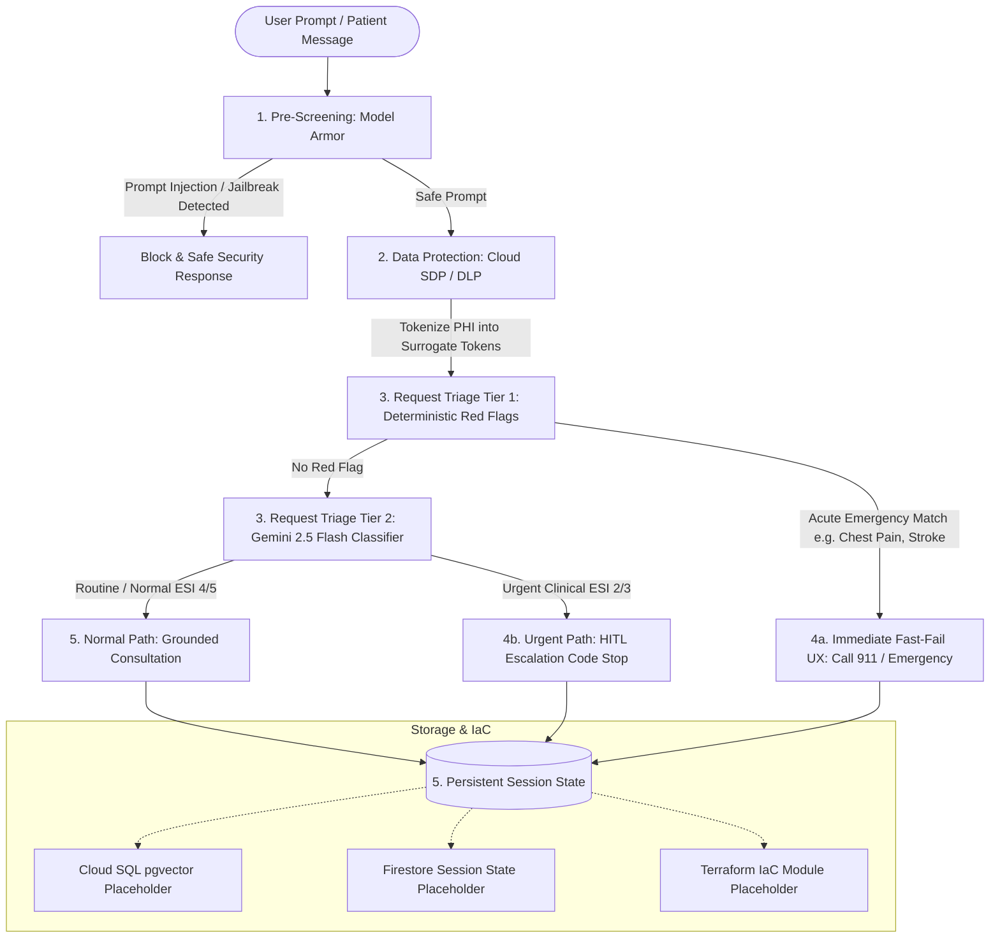

# Implementation Plan: Healthcare Agent with ADK 2.0

## Goal Description
Implement an enterprise-grade Healthcare Triage & Consultation Agent using Google's Agent Development Kit (ADK) 2.0 architecture and Vertex AI ecosystem. The agent incorporates five core components with the recommended architectural pivots to satisfy healthcare compliance, patient safety, and cloud architectural rubrics:

1. **Pre-Screening**: Vertex AI Model Armor to detect and block malicious prompt injections/jailbreaks, while de-identifying PHI before logging (rather than blocking legitimate patient symptom inputs).
2. **Data Protection**: Cloud Sensitive Data Protection (Cloud SDP / DLP) to tokenize direct identifiers (names, dates, MRNs, phone numbers) into surrogate tokens (`[PATIENT_NAME_1]`, `[DATE_1]`) before internal logging or general RAG retrieval.
3. **Request Triage**: Deterministic Two-Tier Triage combining:
   - **Tier 1 (Deterministic / Zero-Latency)**: Hardcoded compiled regex/keyword rule engine for acute red flags (e.g., crushing chest pain, anaphylaxis, FAST stroke signs, acute suicidality).
   - **Tier 2 (Gemini 2.5 Flash Structured Classifier)**: Fast LLM classification with strict Pydantic schemas for severity indexing (ESI 1-5), clinical rationale, and pathway recommendation.
4. **Urgent Path**: 
   - **Immediate Fast-Fail UX**: An AI companion must never sit between an acutely ill patient and emergency services; immediately return direct emergency dispatch instructions (e.g., Call 911 / emergency services).
   - **HITL Code Stop**: Human-in-the-Loop escalation trigger for non-emergency clinical urgencies (e.g., high fever in infant, acute post-op wound changes) without hallucinating unsafe medical prescriptions.
5. **Normal Path & Storage**:
   - Clinical consultation flow with Vertex AI Search / RAG grounding placeholders.
   - Abstract Session State interface with a local working implementation and production placeholders for Cloud SQL (PostgreSQL + `pgvector`) and Google Cloud Firestore.
   - Infrastructure as Code (IaC) Terraform module placeholders for Cloud Run, Cloud SDP, Model Armor, and Firestore.



---

## User Review Required

> [!IMPORTANT]
> **Deterministic Fast-Fail Patient Safety**: In emergency triage (Tier 1 red flags), the agent bypasses all LLM generative stages and instantly outputs hardcoded, authoritative emergency instructions with zero model hallucination risk.
>
> **De-identification Strategy**: Sensitive medical details (symptoms, pain levels, history) are retained for clinical reasoning, but direct patient identifiers (Names, SSNs, MRNs, Phone, Addresses, Dates of Birth) are tokenized into surrogate tokens (`[SURROGATE_NAME_1]`, `[SURROGATE_MRN_1]`) via Cloud SDP to safeguard audit logs and vector databases.
>
> **Modular & Testable Implementation**: While production environments rely on Google Cloud APIs (Model Armor, Cloud DLP, Cloud SQL/Firestore, Vertex AI), all components will provide a local mock/fallback engine so the agent can be tested, demonstrated, and validated immediately without requiring live cloud credentials.

---

## Open Questions

1. **Emergency Numbers & Dispatch Protocol**: The default fast-fail UX instructs calling **911** (US standard) with fallback text for local emergency medical services. Would you like multi-region emergency number support (e.g., 999 UK, 112 EU) configurable via session metadata?
2. **Gemini 2.5 Flash API Key / Credentials**: The code will look for `GEMINI_API_KEY` or Vertex AI Application Default Credentials (`GOOGLE_APPLICATION_CREDENTIALS`). When unavailable, it will automatically fall back to an offline deterministic mock classifier for seamless local testing. Does this fit your testing plan?

---

## Proposed Changes

We will organize the agent codebase cleanly under `src/healthcare_agent/`, with modular components for each rubric requirement:

```
l200/
├── src/
│   └── healthcare_agent/
│       ├── __init__.py
│       ├── config.py                     # Configuration dataclass & settings
│       ├── models/
│       │   ├── __init__.py
│       │   ├── triage_models.py          # Strict Pydantic models for Triage & HITL
│       │   └── session_models.py         # Session state, messages, surrogate maps
│       ├── prescreening/
│       │   ├── __init__.py
│       │   └── model_armor.py            # Vertex AI Model Armor sanitization & jailbreak check
│       ├── data_protection/
│       │   ├── __init__.py
│       │   └── sdp_deidentifier.py       # Cloud Sensitive Data Protection (DLP) tokenization
│       ├── triage/
│       │   ├── __init__.py
│       │   ├── tier1_deterministic.py    # Zero-latency regex & keyword red flag engine
│       │   ├── tier2_classifier.py       # Gemini 2.5 Flash structured Pydantic classifier
│       │   └── router.py                 # Two-Tier triage orchestrator
│       ├── urgent_path/
│       │   ├── __init__.py
│       │   ├── fast_fail.py              # Instant unblockable emergency UX generator
│       │   └── hitl_escalator.py         # Clinical HITL escalation code stop & queue
│       ├── normal_path/
│       │   ├── __init__.py
│       │   └── consultation.py           # Normal clinical consultation with RAG placeholder
│       ├── storage/
│       │   ├── __init__.py
│       │   ├── base.py                   # Abstract SessionStateStore interface
│       │   ├── memory_store.py           # In-memory / SQLite local session store
│       │   ├── firestore_store.py        # [PLACEHOLDER] Cloud Firestore session state
│       │   └── cloud_sql_store.py        # [PLACEHOLDER] Cloud SQL PostgreSQL + pgvector
│       ├── iac/
│       │   ├── main.tf                   # [PLACEHOLDER] Terraform config for Cloud Run/DLP/Armor
│       │   ├── variables.tf              # Terraform variables
│       │   └── outputs.tf                # Terraform outputs
│       ├── agent.py                      # ADK 2.0 HealthcareAgent core pipeline
│       └── demo.py                       # Automated verification runner for all 5 scenarios
├── tests/
│   ├── __init__.py
│   ├── test_tier1_triage.py              # Unit tests for deterministic red flags
│   ├── test_sdp_tokenization.py          # Unit tests for surrogate de-identification
│   ├── test_model_armor.py               # Unit tests for prompt injection screening
│   └── test_urgent_hitl.py               # Unit tests for fast-fail UX & HITL code stops
├── pyproject.toml                        # Project dependencies (pydantic, google-genai, etc.)
└── README.md                             # Architectural documentation & rubric alignment
```

---

### Component Specifications

#### 1. Models & Configuration (`src/healthcare_agent/models/` & `config.py`)
- `triage_models.py`:
  - `TriageCategory`: Enum (`EMERGENCY`, `URGENT_CLINICAL`, `ROUTINE_CONSULT`, `ADMINISTRATIVE`)
  - `EmergencySeverityIndex`: IntEnum (1: Resuscitation, 2: Emergent, 3: Urgent, 4: Less Urgent, 5: Non-Urgent)
  - `TriageClassification`: Strict Pydantic model with `category`, `esi_level`, `confidence`, `detected_red_flags`, `clinical_rationale`, `recommended_pathway`.
  - `HITLEscalationPayload`: Clinician notification payload with anonymized context, escalation reason, timestamp, and review status.

#### 2. Pre-Screening: Model Armor (`src/healthcare_agent/prescreening/model_armor.py`)
- Checks user prompt against prompt injection and jailbreak attacks using Vertex AI Model Armor client.
- When live credentials are absent, employs an intelligent security heuristics engine checking for system prompt override attempts, roleplay jailbreaks, and adversarial delimiter attacks.
- Returns `ModelArmorResult(is_safe: bool, blocked_reason: Optional[str], sanitized_prompt: str)`.

#### 3. Data Protection: Cloud SDP / DLP (`src/healthcare_agent/data_protection/sdp_deidentifier.py`)
- Detects PHI info types (Names, SSNs, Medical Record Numbers, Phone Numbers, Email, Addresses, Dates of Birth).
- Replaces direct identifiers with surrogate tokens: e.g. `John Doe, born 1980-05-12, MRN 482910` becomes `[PATIENT_NAME_1], born [DATE_1], MRN [MEDICAL_ID_1]`.
- Maintains a secure in-memory surrogate mapping for authorized downstream detokenization while ensuring sanitized prompts are logged.

#### 4. Request Triage: Deterministic Two-Tier Triage (`src/healthcare_agent/triage/`)
- **Tier 1 (`tier1_deterministic.py`)**:
  - Precompiled regex dictionary covering:
    - Cardiovascular: crushing chest pain, radiating jaw/left arm pain, diaphoresis.
    - Respiratory: severe shortness of breath, stridor, choking, cyanosis / blue lips.
    - Neurological: FAST symptoms (facial drooping, arm weakness, slurred speech), sudden severe thunderclap headache.
    - Anaphylaxis: throat swelling, airway constriction following allergen exposure.
    - Trauma / Severe Hemorrhage: arterial bleeding, uncontrollable hemorrhage.
    - Crisis / Self-Harm: explicit suicidal ideation or intent.
  - Returns `Tier1Result(is_red_flag: bool, matched_condition: Optional[str], details: str)`.
- **Tier 2 (`tier2_classifier.py`)**:
  - Invokes Gemini 2.5 Flash with structured output schema enforcing `TriageClassification`.
  - Classifies ESI level and pathway recommendations.
- **Router (`router.py`)**:
  - Evaluates Tier 1 first; if red flag triggered, immediately returns `EMERGENCY` without invoking LLM. Otherwise, proceeds to Tier 2.

#### 5. Urgent Path & Fast-Fail UX (`src/healthcare_agent/urgent_path/`)
- **Fast-Fail UX (`fast_fail.py`)**:
  - Implements immediate life-safety guidance: Call 911 / Emergency, stay on the line, unlock door, gather immediate medications, DO NOT wait for an AI response.
- **HITL Escalation (`hitl_escalator.py`)**:
  - For non-emergency clinical urgencies (ESI Level 2/3, e.g., persistent high fever, spreading infection):
  - Suspends automated generative advice ("code stop").
  - Emits a structured `HITLEscalationPayload` to the clinical queue.
  - Informs the patient that their case has been escalated to an on-call medical professional with expected turnaround time.

#### 6. Normal Path & Storage (`src/healthcare_agent/normal_path/` & `storage/`)
- `consultation.py`: Grounded medical Q&A with conversational memory, symptom clarification, and lifestyle/home-care guidance with clinical disclaimer.
- `storage/base.py`: Abstract `SessionStateStore` with `get_session`, `save_session`, `append_message`.
- `storage/memory_store.py`: Working local session store for testing and state verification.
- `storage/firestore_store.py`: **[PLACEHOLDER]** Cloud Firestore implementation with documented schema, TTL policies, and connection pooling.
- `storage/cloud_sql_store.py`: **[PLACEHOLDER]** Cloud SQL PostgreSQL with `pgvector` schema for persistent session history and semantic memory search.
- `iac/main.tf`: **[PLACEHOLDER]** Terraform module defining Cloud Run service, Vertex AI Model Armor template, Cloud DLP de-identify template, and Firestore database.

---

## Verification Plan

### Automated Tests
1. **Tier 1 Red Flag Unit Tests (`tests/test_tier1_triage.py`)**:
   - Verify deterministic detection for acute chest pain, anaphylaxis, stroke signs, severe hemorrhage.
   - Verify zero false positives for routine symptoms (e.g. mild sore throat, paper cut).
2. **Cloud SDP Tokenization Unit Tests (`tests/test_sdp_tokenization.py`)**:
   - Verify patient names, dates, phone numbers, and MRNs are replaced by surrogate tokens.
   - Verify surrogate mapping bidirectional consistency.
3. **Model Armor Unit Tests (`tests/test_model_armor.py`)**:
   - Verify prompt injection and jailbreak attempts are flagged and blocked.
   - Verify normal healthcare queries pass through unblocked.
4. **Urgent Path & HITL Unit Tests (`tests/test_urgent_hitl.py`)**:
   - Verify fast-fail UX outputs authoritative emergency instructions.
   - Verify HITL code stop creates structured payload and halts unvetted clinical advice.

### End-to-End Demo Script (`src/healthcare_agent/demo.py`)
Run the demo script simulating all 5 key user scenarios:
- **Scenario 1**: Malicious prompt injection attempt -> Blocked by Model Armor.
- **Scenario 2**: Patient inquiry with PHI -> Tokenized by Cloud SDP before logging.
- **Scenario 3**: Acute emergency ("crushing chest pain radiating to left arm") -> Tier 1 instantaneous fast-fail emergency UX.
- **Scenario 4**: Urgent clinical inquiry ("fever 103F in 2-month infant") -> Tier 2 Gemini ESI 2 classification -> HITL escalation code stop.
- **Scenario 5**: Routine inquiry ("how to treat mild ankle sprain") -> Normal path grounded consultation + persistent session storage update.

### Command Execution
```bash
python3 -m unittest discover tests/
python3 src/healthcare_agent/demo.py
```
