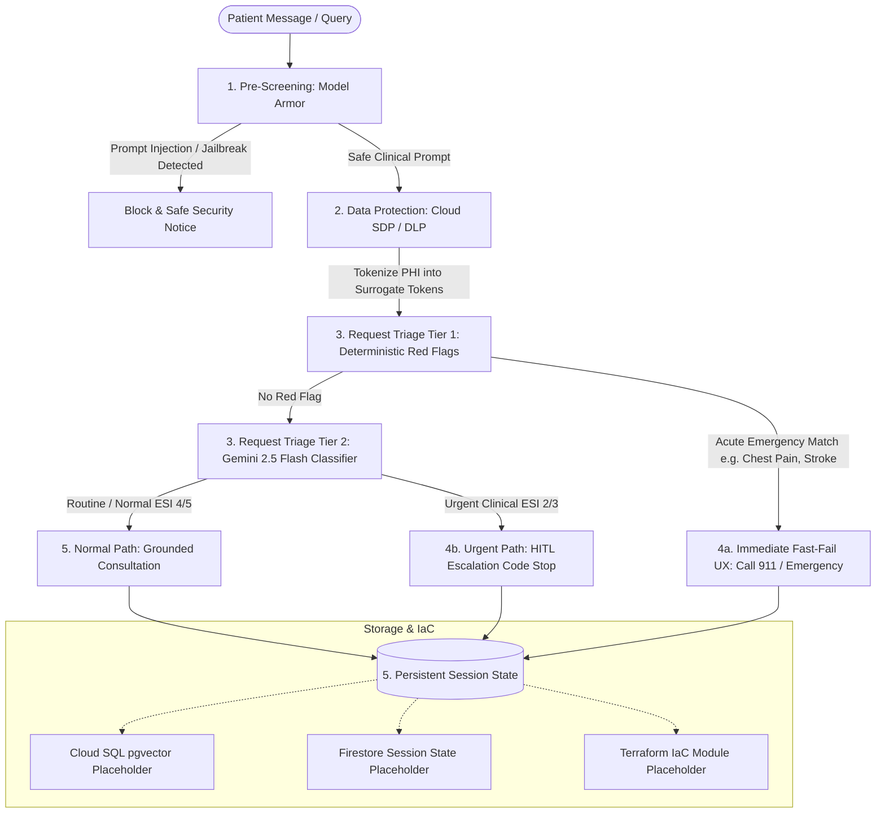

# Healthcare Triage & Consultation Agent (ADK 2.0 & Vertex AI)

Enterprise-grade Healthcare Triage & Consultation Agent built with Google's Agent Development Kit (ADK) 2.0 architecture and Vertex AI ecosystem.

Designed with healthcare compliance, patient safety, and cloud architectural rubrics:
1. **Pre-Screening**: Vertex AI Model Armor detection of prompt injections and jailbreaks without blocking legitimate patient symptoms.
2. **Data Protection**: Cloud Sensitive Data Protection (SDP / Cloud DLP) surrogate tokenization (`[PATIENT_NAME_1]`, `[DATE_1]`, `[MEDICAL_ID_1]`) prior to logging and vector storage.
3. **Request Triage**: Deterministic Two-Tier Triage combining:
   - **Tier 1 (Deterministic / Zero-Latency)**: Pre-compiled regex rule engine for acute red flags (crushing chest pain, stroke FAST symptoms, anaphylaxis, severe hemorrhage).
   - **Tier 2 (Gemini 2.5 Flash Structured Classifier)**: Fast severity indexing according to the Emergency Severity Index (ESI 1–5).
4. **Urgent Path**:
   - **Immediate Fast-Fail UX**: Instant emergency dispatch instructions (Call 911 / unlock door / stay on line) with zero generative latency and zero hallucination risk.
   - **HITL Code Stop**: Clinical Human-in-the-Loop escalation trigger for non-emergency urgencies (e.g. infant with fever, post-op wound dehiscence).
5. **Normal Path & Storage**: Grounded consultation with medical disclaimers, abstract session state interface, and production Cloud SQL (pgvector) / Firestore / Terraform IaC placeholders.

---

## Architecture Flow



---

## Project Structure

```
l200/
├── src/
│   └── healthcare_agent/
│       ├── __init__.py
│       ├── config.py                     # Configuration dataclass & settings
│       ├── models/
│       │   ├── __init__.py
│       │   ├── triage_models.py          # Strict Pydantic models for Triage & HITL
│       │   └── session_models.py         # Session state, messages, surrogate maps
│       ├── prescreening/
│       │   ├── __init__.py
│       │   └── model_armor.py            # Vertex AI Model Armor sanitization & jailbreak check
│       ├── data_protection/
│       │   ├── __init__.py
│       │   └── sdp_deidentifier.py       # Cloud Sensitive Data Protection (DLP) tokenization
│       ├── triage/
│       │   ├── __init__.py
│       │   ├── tier1_deterministic.py    # Zero-latency regex & keyword red flag engine
│       │   ├── tier2_classifier.py       # Gemini 2.5 Flash structured Pydantic classifier
│       │   └── router.py                 # Two-Tier triage orchestrator
│       ├── urgent_path/
│       │   ├── __init__.py
│       │   ├── fast_fail.py              # Instant unblockable emergency UX generator
│       │   └── hitl_escalator.py         # Clinical HITL escalation code stop & queue
│       ├── normal_path/
│       │   ├── __init__.py
│       │   └── consultation.py           # Normal clinical consultation with RAG placeholder
│       ├── storage/
│       │   ├── __init__.py
│       │   ├── base.py                   # Abstract SessionStateStore interface
│       │   ├── memory_store.py           # In-memory session store
│       │   ├── firestore_store.py        # [PLACEHOLDER] Cloud Firestore session state
│       │   └── cloud_sql_store.py        # [PLACEHOLDER] Cloud SQL PostgreSQL + pgvector
│       ├── iac/
│       │   ├── main.tf                   # [PLACEHOLDER] Terraform config for Cloud Run/DLP/Armor
│       │   ├── variables.tf              # Terraform variables
│       │   └── outputs.tf                # Terraform outputs
│       ├── agent.py                      # ADK 2.0 HealthcareAgent core pipeline
│       └── demo.py                       # Automated verification runner for all 5 scenarios
├── tests/
│   ├── __init__.py
│   ├── test_tier1_triage.py              # Unit tests for deterministic red flags
│   ├── test_sdp_tokenization.py          # Unit tests for surrogate de-identification
│   ├── test_model_armor.py               # Unit tests for prompt injection screening
│   └── test_urgent_hitl.py               # Unit tests for fast-fail UX & HITL code stops
├── pyproject.toml                        # Project dependencies
└── README.md                             # Architectural documentation
```

---

## Verification & Testing

### Quick Test Script (All-in-One)
```bash
./test_agent.sh
```
This launches a quick menu where you can choose:
1. **Interactive Chat**: Enter any symptom, PHI, or adversarial query.
2. **Automated Demo**: Runs all 5 rubric scenarios.
3. **Unit Tests**: Runs all 19 automated tests.

---

### Direct Commands

#### Interactive Chat Console
```bash
/Library/GoogleCorpSupport/bin/python3 src/healthcare_agent/cli.py
```

#### Running Unit Tests
```bash
/Library/GoogleCorpSupport/bin/python3 -m unittest discover tests/
```

#### Running the End-to-End Demo
```bash
/Library/GoogleCorpSupport/bin/python3 src/healthcare_agent/demo.py
```
